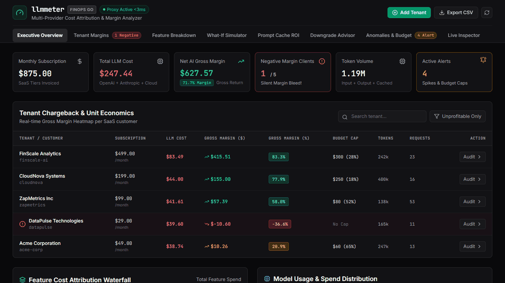
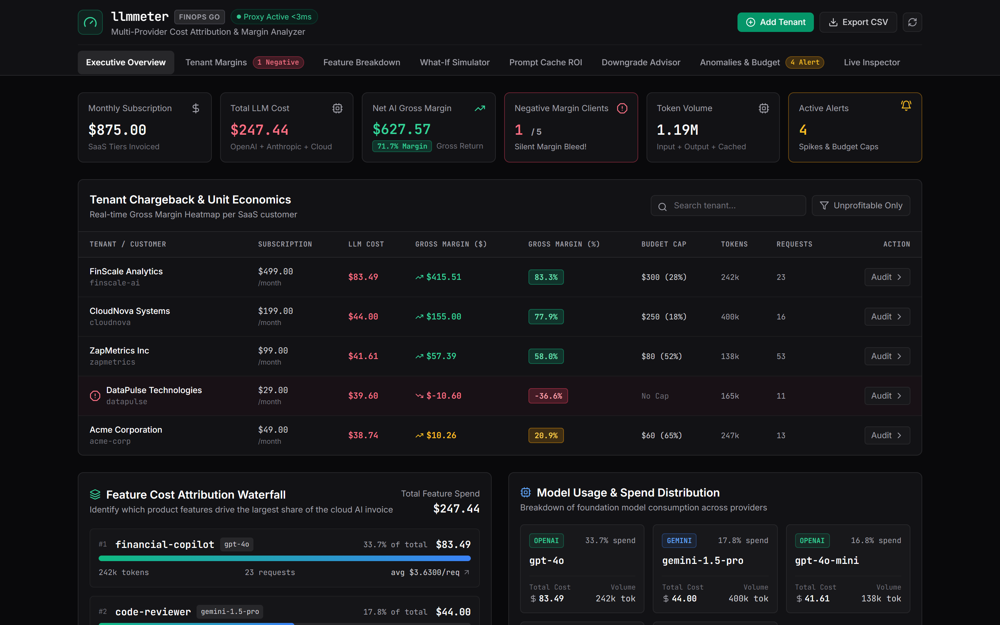
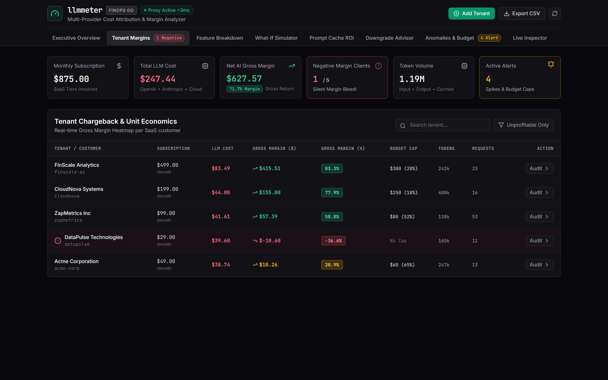
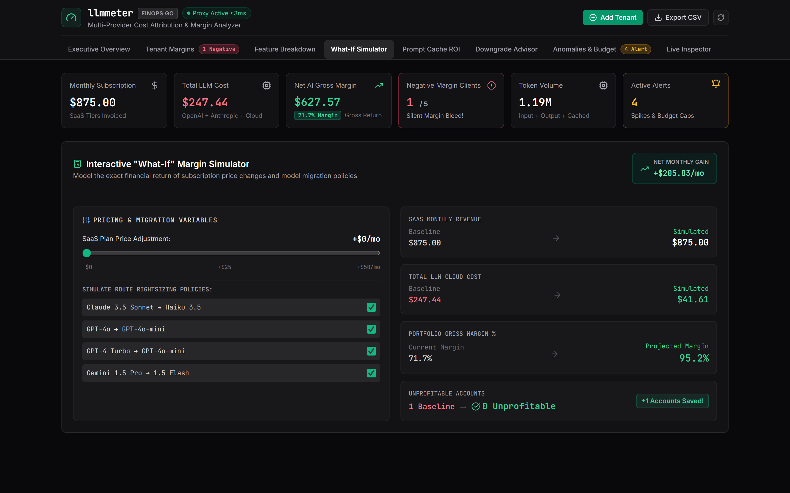
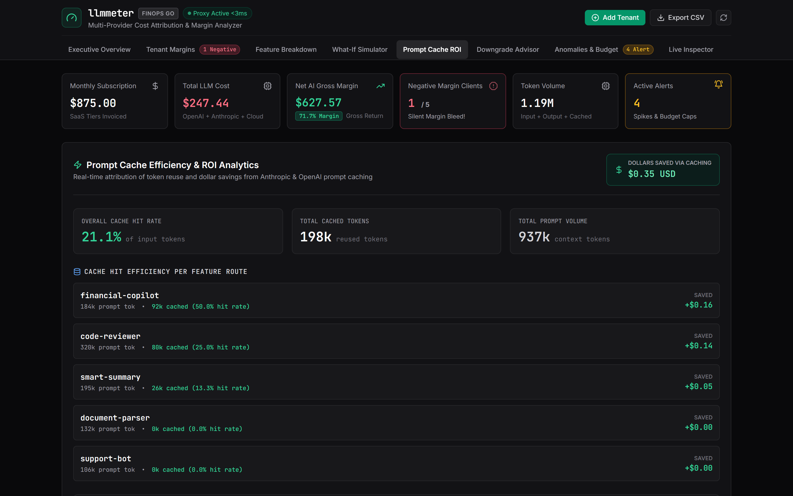
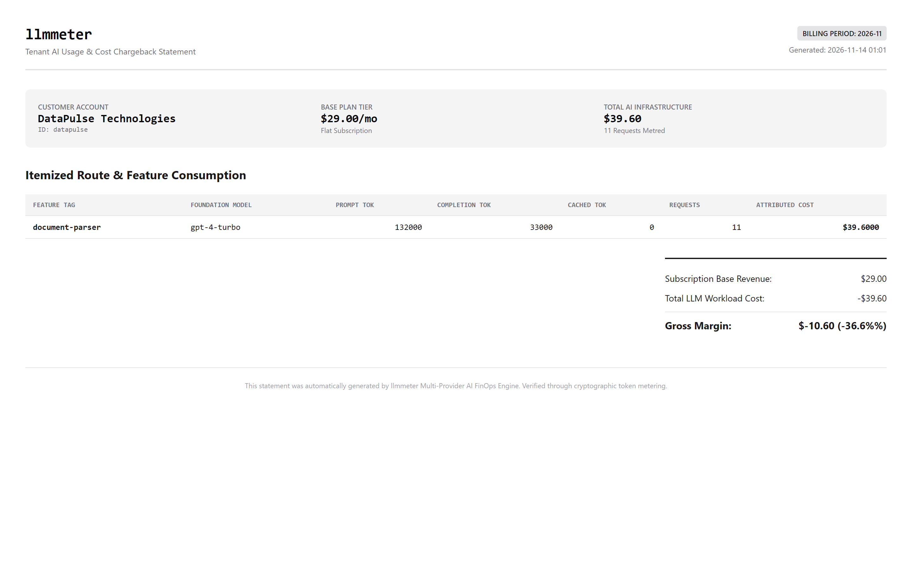
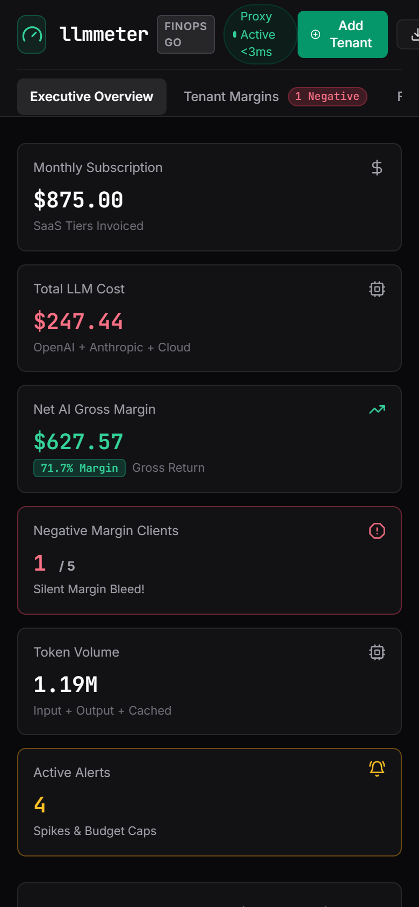

<p align="center">
  
</p>

<h1 align="center">llmmeter</h1>

<p align="center">
  <strong>Multi-Provider LLM Cost Attribution, Tenant Chargeback &amp; Margin Analyzer</strong><br />
  Single Go binary reverse proxy (&lt;20MB RAM, &lt;3ms latency) with embedded React 19 FinOps Studio.
</p>

<p align="center">
  <a href="https://github.com/alexandrmotologa/llmmeter/actions"></a>
  <a href="https://go.dev"></a>
  <a href="https://react.dev"></a>
  <a href="https://sqlite.org"></a>
  <a href="#license"></a>
</p>

---

## Interactive Demo



---

## The Problem

Software companies that sell AI features on flat monthly subscription tiers (e.g. $29 or $49 per month) frequently suffer from negative gross margins on power-user accounts. A single customer paying $49 per month can easily consume $83 worth of Claude 3.5 Sonnet or GPT-4o tokens, quietly eroding company profitability.

Without granular per-tenant token metering and cost attribution, engineering teams and finance leaders only discover this margin bleed when the aggregate monthly cloud bill arrives from OpenAI or Anthropic.

`llmmeter` solves this problem. It acts as a transparent, high-performance reverse proxy positioned between your application servers and upstream LLM providers, calculating exact gross margins per customer in real time.

---

## Key Capabilities

- **Sub-3ms Reverse Proxy**: Forwards requests to OpenAI, Anthropic, Gemini, Groq, Mistral, and Bedrock with zero buffering SSE streaming.
- **Tenant Cost Attribution**: Tracks token volumes and dollars per tenant using `X-Tenant-ID` or prefixed API keys (`sk-t{tenant}-{key}`).
- **Feature Cost Attribution**: Identifies which specific application features (e.g. search, summarization, copilot) drive the monthly cloud invoice via `X-Feature-Tag`.
- **Gross Margin Engine**: Compares customer subscription tiers against exact LLM token costs in real time:
  `Gross Margin % = ((Subscription Revenue - LLM Cost) / Subscription Revenue) * 100`
- **Dynamic Auto-Rightsizing**: Automatically redirects requests from accounts operating at negative gross margin to cost-effective alternatives (e.g. Claude 3.5 Sonnet to Claude 3.5 Haiku) with header `X-Auto-Rightsizing: true`.
- **Semantic Caching & Token ROI**: In-memory semantic hash cache delivering sub-millisecond latency (`X-Cache: HIT`) and real-time dollar tracking on Anthropic and OpenAI prompt caching.
- **Circuit Breakers & Rate Limits**: Per-tenant RPM/TPM sliding windows and runaway agent loop circuit breakers that trip if tenant spend surges beyond configured thresholds.
- **Prometheus Observability**: Native `/metrics` endpoint with Prometheus counters and histograms for Grafana and Datadog monitoring.
- **Interactive What-If Simulator**: Interactive UI modeling the exact dollar gains of plan price changes and model migration policies before deploying code changes.
- **Auditor Tenant Statements**: Generates print-ready HTML and JSON customer invoice statements for FinOps teams and accounting reconciliations.
- **Anomaly Detection**: Flags individual requests that cost more than 3x the tenant 30-day baseline.
- **Budget Guardrails**: Enforces monthly budget caps per customer. Throttles requests with HTTP 429 when limits are reached.
- **Downgrade Advisor**: Scans routes with negative margins and suggests cheaper model substitutions with projected monthly savings.
- **Embedded Web Cockpit**: Ships with a dark-theme React 19 dashboard inside the Go binary. Uses under 20MB of RAM.

---

## Architecture

```
       +--------------------------------------------------------+
       |             SaaS Backend Application                   |
       |  (Routes requests with `X-Tenant-ID: acme-corp`)       |
       +--------------------------------------------------------+
                                   |
                                   | HTTP / SSE streaming
                                   v
       +--------------------------------------------------------+
       |                    llmmeter Proxy                      |
       |             (Single Go Binary, Port 8080)              |
       +--------------------------------------------------------+
                                   |
                     +-------------+-------------+
                     |                           |
                     v                           v
     +-------------------------------+   +-------------------------------+
     |     Live Token & Cost Meter   |   |     Upstream Provider Gateway |
     | - Input / Output / Cached Tok |   | - OpenAI / Anthropic / Gemini |
     | - Live Price Matrix           |   | - SSE Chunk Passthrough       |
     | - Computes Exact USD Cost     |   | - Zero Buffering Latency      |
     +-------------------------------+   +-------------------------------+
                     |                           |
                     +-------------+-------------+
                                   |
                                   v
       +--------------------------------------------------------+
       |          SQLite FinOps Storage (WAL Mode)              |
       |  - Usage Records & Cost Aggregates                     |
       |  - Tenant Gross Margin Tables                          |
       +--------------------------------------------------------+
                                   |
                     +-------------+-------------+
                     |                           |
                     v                           v
       +---------------------------+   +---------------------------+
       | React 19 FinOps Studio    |   | Prometheus /metrics       |
       | - Margin Heatmap          |   | - Latency Histograms      |
       | - What-If Simulator       |   | - Token & Cost Counters   |
       | - Downgrade Advisor       |   | - Cache Hit Ratios        |
       +---------------------------+   +---------------------------+
```

---

## FinOps Cockpit Walkthrough

### 1. Executive Overview & Real-Time Margin Heatmap
Instant visibility into portfolio-wide gross margins, active alerts, token volumes, and unprofitable accounts.



### 2. Tenant Unit Economics & Negative Margin Warnings
Live audit table comparing monthly customer subscription pricing against cumulative LLM infrastructure costs.



### 3. Interactive "What-If" Gross Margin Simulator
Model the financial return of SaaS subscription price adjustments and model rightsizing policies before updating code.



### 4. Prompt Cache Efficiency & Dollar Savings
Track token reuse percentages and exact dollars saved across OpenAI and Anthropic prompt caching routes.



### 5. Printable Customer Audit Statements
Generates official, print-ready billing audit reports for finance departments and enterprise customer reviews.



### 6. Responsive UI on Mobile Devices
Full responsiveness across smartphones, tablets, and desktop workstations.

<p align="center">
  
</p>

---

## Quick Start

### 1. Build and Run

```bash
# Clone the repository
git clone https://github.com/alexandrmotologa/llmmeter.git
cd llmmeter

# Build the binary (includes embedded frontend)
make build

# Seed realistic demo data
./bin/llmmeter demo --db ./finops.db

# Start proxy and analytics dashboard
./bin/llmmeter serve --port 8080 --db ./finops.db
```

Open `http://localhost:8080` in your browser to view the FinOps dashboard.

### 2. Route LLM Requests Through llmmeter

Point your OpenAI or Anthropic SDK base URL to `http://localhost:8080/v1` and pass tenant headers:

```bash
curl http://localhost:8080/v1/chat/completions \
  -H "Content-Type: application/json" \
  -H "Authorization: Bearer $OPENAI_API_KEY" \
  -H "X-Tenant-ID: acme-corp" \
  -H "X-Feature-Tag: smart-summary" \
  -d '{
    "model": "gpt-4o-mini",
    "messages": [{"role": "user", "content": "Summarize monthly financials."}]
  }'
```

### 3. Generate Executive Margin Audit Report

```bash
./bin/llmmeter report --month 2026-11
```

Terminal output:

```
========================================================================
                      llmmeter FinOps Engine
    Multi-Provider LLM Cost Attribution, Tenant Chargeback & Margin
========================================================================
Executive Customer Gross Margin Audit Report - Month: 2026-11

TENANT ID     NAME                     SUBSCRIPTION   LLM COST   GROSS MARGIN   MARGIN %   STATUS
---------     ----                     ------------   --------   ------------   --------   ------
finscale-ai   FinScale Analytics       $499.00        $83.49     $415.51        83.3%      HEALTHY
cloudnova     CloudNova Systems        $199.00        $44.00     $155.00        77.9%      HEALTHY
zapmetrics    ZapMetrics Inc           $99.00         $40.82     $58.18         58.8%      HEALTHY
datapulse     DataPulse Technologies   $29.00         $39.60     $-10.60        -36.6%     NEGATIVE MARGIN (BLEED!)
acme-corp     Acme Corporation         $49.00         $38.74     $10.26         20.9%      THIN MARGIN

------------------------------------------------------------------------
Total Invoiced SaaS Revenue:  $875.00
Total LLM Infrastructure:     $246.65
Portfolio AI Gross Margin:    $628.35 (71.8%)
Negative Margin Customers:    1 / 5
------------------------------------------------------------------------
```

### 4. Export Negative Margin Accounts to CSV

```bash
./bin/llmmeter export-negative-margins --output ./unprofitable_tenants.csv
```

---

## CLI Reference

| Command | Description |
| --- | --- |
| `llmmeter serve [--port 8080] [--db ./finops.db]` | Starts reverse proxy and web UI |
| `llmmeter report [--month YYYY-MM] [--db ./finops.db]` | Displays executive margin audit table |
| `llmmeter export-negative-margins [--output file.csv]` | Exports unprofitable accounts to CSV |
| `llmmeter sync-pricing` | Displays current token pricing matrix for 35+ models |
| `llmmeter demo [--db ./finops.db]` | Seeds enterprise sample data for evaluation |
| `llmmeter version` | Displays version and build runtime details |

---

## Supported Providers & Models

- **OpenAI**: GPT-4o, GPT-4o-mini, GPT-4 Turbo, GPT-3.5 Turbo, o1, o1-mini, o3-mini, Embeddings
- **Anthropic**: Claude 3.5 Sonnet, Claude 3.5 Haiku, Claude 3 Opus
- **Google Gemini**: Gemini 1.5 Pro, Gemini 1.5 Flash, Gemini 2.0 Flash
- **Groq**: Llama 3.1 (70B, 8B), Mixtral 8x7B
- **Mistral**: Mistral Large, Mistral Small, Codestral
- **AWS Bedrock**: Claude and Llama via `bedrock/` prefix

---

## Storage Schema

`llmmeter` stores usage events in SQLite with Write-Ahead Logging (WAL) enabled:

```sql
CREATE TABLE tenants (
    id TEXT PRIMARY KEY,
    name TEXT NOT NULL,
    monthly_plan_usd REAL NOT NULL DEFAULT 0.0,
    monthly_budget_usd REAL,
    webhook_url TEXT,
    created_at TIMESTAMP DEFAULT CURRENT_TIMESTAMP
);

CREATE TABLE request_logs (
    id TEXT PRIMARY KEY,
    tenant_id TEXT NOT NULL REFERENCES tenants(id),
    feature_tag TEXT NOT NULL,
    user_id TEXT,
    provider TEXT NOT NULL,
    model TEXT NOT NULL,
    prompt_tokens INTEGER NOT NULL,
    completion_tokens INTEGER NOT NULL,
    cached_tokens INTEGER DEFAULT 0,
    cost_usd REAL NOT NULL,
    latency_ms INTEGER NOT NULL,
    timestamp TIMESTAMP DEFAULT CURRENT_TIMESTAMP
);
```

---

## Documentation

- [Architecture Guide](docs/architecture.md)
- [API Reference](docs/api-reference.md)
- [Deployment & Docker Guide](docs/deployment.md)

---

## License

MIT License. See [LICENSE](LICENSE) for details.
